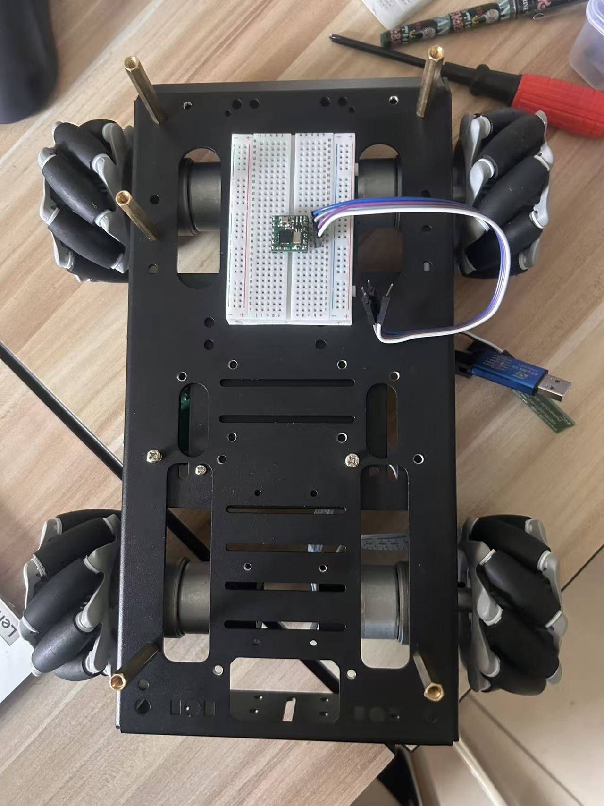

# 自动巡检小车：二轮差速与麦克纳姆平台

本仓库保存两套机器人系统的固件、ROS 2 工程、硬件资料和开发记录。**F103 二轮差速系统作为历史参考，F407 麦克纳姆系统作为当前开发主线。** 两套车型独立管理，不应混用运动学、地图参数、底盘控制器或电机标定数据。

## 当前进度（2026-11-03）

根据开发者现场反馈，麦克纳姆小车已经完成实物平台上的 Nav2 部署与初步导航联调，上位机使用**鲁班猫 RK3588**。目前路径跟踪与底盘运动仍存在偏差，**尚不能正常完成导航任务**。现阶段使用 Nav2 提供的规划与控制组件，偏差根因尚未通过测量定位，不能直接认定为规划算法问题。

本次提交进行仓库分类、文档补充与图片原件归档。按用户要求，未运行项目代码、编译、仿真或实车测试，也未修改控制算法。目录整理不代表新功能已经实现。

## 两套系统入口

| 系统 | 底盘 | 上位机与仿真 | 定位 |
|---|---|---|---|
| [F103 二轮差速](platforms/differential_f103/README.md) | 原 STM32F103 固件及测试 | 原差速 ROS 2 / Gazebo / Nav2 工程 | 历史开发与实验参考 |
| [F407 麦克纳姆](platforms/mecanum_f407/README.md) | STM32F407 四轮控制、编码器及 IMU | 实车 ROS 2 工作区；麦轮仿真待补齐 | 当前开发主线 |

原差速仿真归入 F103 车型，不表示已经验证它与 F103 固件的完整实车联调。原仿真历史环境为 Ubuntu 24.04 ARM64、ROS 2 Jazzy；不能据此推定当前鲁班猫的软件版本。

## 仓库结构

```text
platforms/
├── differential_f103/
│   ├── firmware/                # 原 chassis，含原有测试与文档
│   ├── ros2_ws/                 # 原 chapt6_ws，差速仿真与巡检示例
│   ├── calibration/             # 原 data，旧电机采样与标定
│   └── legacy_upper_computer/   # 旧上位机说明、雷达实验及照片
└── mecanum_f407/
    ├── firmware/                # 原 chassis_f407，含 Keil 与硬件资料
    ├── ros2_ws/                 # 原 mecanumws
    │   ├── src/chassis_bridge/
    │   ├── src/sllidar_ros2-main/
    │   ├── config/
    │   └── maps/
    ├── hardware/                # 新补充的硬件索引及图片原件
    └── docs/daily/              # 每日开发记录
```

完整迁移关系见[目录迁移说明](docs/repository-layout.md)。历史文档中的旧路径和旧设备描述保留原有语境，不能当作当前部署事实。

## 麦克纳姆实物



此图为底盘装配阶段照片，不是完整的导航整机展示。原图保留真实接线、轮子与安装结构；图片展示不作为尺寸测量依据。商品尺寸与编码器截图见[硬件资料](platforms/mecanum_f407/hardware/README.md)。

## 当前软件链路

实车 ROS 2 速度指令经 `chassis_bridge` 转成串口命令，下位机执行麦轮运动学和四轮速度闭环，回传位姿。上位机发布里程计及 TF，激光雷达提供扫描，建图或定位导航组件使用这些数据。

- 下发：115200 8N1，约 20Hz，ASCII 格式 `[v,vx,vy,wz]`，单位为 m/s、m/s、rad/s。
- 下位机：现有配置为 300ms 有效命令超时；该值不是整车实际停车时间。
- 回传：24 字节二进制位姿帧，带序号、MCU 时间戳和 CRC16，计划频率 50Hz。
- 坐标：车体前、左、逆时针为正；MCU 本地里程计原点不是地图原点。
- 当前桥由位姿差分估算速度，并发布 `odom → base_link`。

详细固件说明见[F407 固件文档](platforms/mecanum_f407/firmware/README.md)。上述为仓库代码描述，实际运行版本应在每次实验记录中填写。

## 使用与部署边界

两套 `ros2_ws` 分别构建，不建议同时加入同一个 ROS overlay。固件工程入口分别位于 F103 的 `firmware/project.uvprojx` 与 F407 的 `firmware/MDK-ARM/F407_HAL_Template.uvprojx`。相对目录整体保留，但本次未做构建验证。

当前实车入口仍在 `sllidar_ros2` 包中：`map_start.launch.py` 用于建图，`start_nv2.launch.py` 用于定位导航。这些启动文件仍包含 `/home/cat/mecanumws/` 默认路径，迁移后的目录不会自动修改板端路径，需要通过启动参数指定实际地图与配置位置。

**当前导航入口有已知隔离问题：** `chassis_cmd_topic` 参数声明后未用于底盘节点重映射，桥仍订阅 `/cmd_vel`。因此不能将该参数或其注释视为已实现的运动隔离。此提交只记录问题，未修复代码。

## 已知问题与下一阶段

1. 导航轨迹与实际底盘运动存在偏差：先区分底盘执行、里程计、定位与控制器各层误差。
2. 串口桥尚无完整断线重连与 MCU 重启处置；遥测失效尚未与运动许可联动。
3. MCU IMU 连续性失效会使里程计失效，当前缺少运行中的恢复流程。
4. `nav2_real.yaml` 已使用全向模型；旁边旧参数仍有差速配置，不能混用。
5. 旧巡检示例的到点判断、照片覆盖及语音结果处理需要改造后再迁入主线。
6. 麦轮仿真尚待建立，不能把旧差速仿真结果当作麦轮验收结果。

后续顺序建议：运动隔离与故障停车 → 底盘和里程计标定 → 定位及导航联调 → 麦轮仿真与实车接口统一 → 巡检任务管理。未经实测不填写误差指标或成功率。

## 每日记录

[2026-11-03：麦克纳姆实车 Nav2 初步联调](platforms/mecanum_f407/docs/daily/2026-11-03.md)

每次有开发或实验时记录日期、代码版本、运行环境、完成事项、现象、测量数据、问题和下一步。用户现场反馈、代码分析、商品标称与实测结果分别标注；不自动补写没有依据的每日成果。

## 历史资料

- [F407 开发历史](docs/f407-development-history.md)
- [原项目介绍](docs/legacy-project-2026-11-02.md)
- [早期麦轮迁移计划](docs/mecanum-migration.md)：属于历史计划，其中串口桥现已加入仓库，当前状态以本 README 和每日记录为准。

第三方代码保留原许可证；商品截图用于参数来源记录，不代表所有选配模块均已安装。
