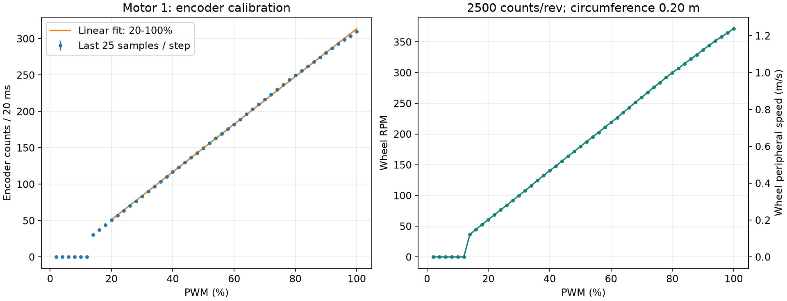

# 电机 1 PWM 标定

来源：vofa+.csv，2795 行；SHA256：b5eb90dee13f28aa6e4218ba0a535b57054f002a7f2ff0ba499c14db3d8591e0。
I0 为每采样周期编码增量，I1 为 PWM 百分数。原始文件未修改。

## 方法及条件

按固件采样周期 20 ms、轮子每圈 2500 计数、周长 0.20 m 换算。
CSV 无时间戳，不能独立验证实际采样周期或是否丢包。
2% 至 100% 每档有 50 点；每档剔除前 25 点，取后 25 点作为稳定段估计。
起始和结束的 PWM=0 区间不参与拟合，避免混入停车过渡。
标准差为每档后 25 点的样本标准差，不是多次实验的重复性误差。

RPM = 编码增量 × 1.2；轮缘线速度(m/s) = 编码增量 × 0.004。
线速度为轮缘速度；车辆实际地速还取决于打滑。

## 结果

| PWM (%) | Counts / 20 ms | Wheel RPM | Speed (m/s) |
|---:|---:|---:|---:|
| 12 | 0.00 | 0.00 | 0.0000 |
| 14 | 30.56 | 36.67 | 0.1222 |
| 20 | 50.56 | 60.67 | 0.2022 |
| 30 | 83.24 | 99.89 | 0.3330 |
| 40 | 116.92 | 140.30 | 0.4677 |
| 50 | 149.68 | 179.62 | 0.5987 |
| 60 | 182.36 | 218.83 | 0.7294 |
| 70 | 216.28 | 259.54 | 0.8651 |
| 80 | 249.80 | 299.76 | 0.9992 |
| 90 | 280.64 | 336.77 | 1.1226 |
| 100 | 309.48 | 371.38 | 1.2379 |

本次上升扫描从 14% 档开始持续转动；低档偶发计数不视为持续启动。
这不代表每次从静止启动都能使用同一个阈值。

对 20%～100% 的 41 个稳定段均值作等权线性拟合，P 为 0～100 的 PWM 百分数：

- 编码增量 ≈ 3.280042 P -14.452265
- 车轮 RPM ≈ 3.936050 P -17.342718
- 轮缘线速度(m/s) ≈ 0.01312017 P -0.05780906
- R² = 0.99976670；最大绝对残差 = 4.072 计数/20 ms。

可将 P ≈ (目标 RPM +17.342718) / 3.936050 作为后续前馈初值，
只适用于本次测试条件和拟合范围；零速直接输出 0，低速启动需要单独处理，不能用线性外推替代启动阈值。
最终用编码器闭环修正供电、负载等变化，另一个电机及反转方向需要分别标定。

