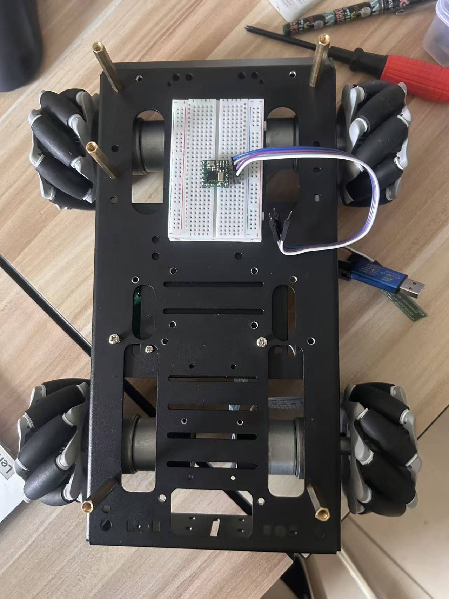
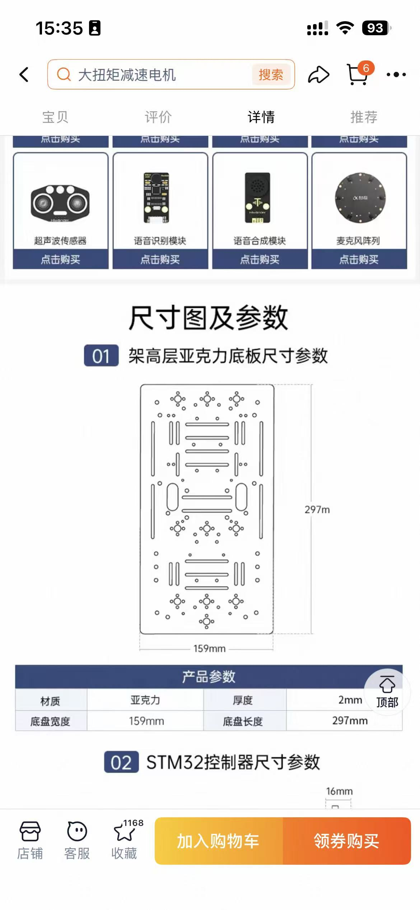
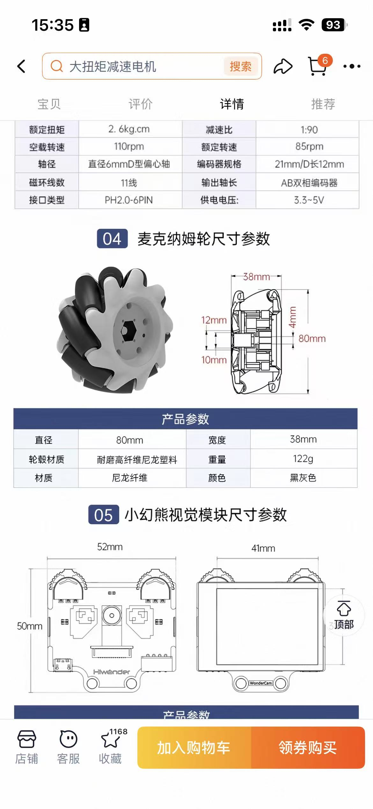
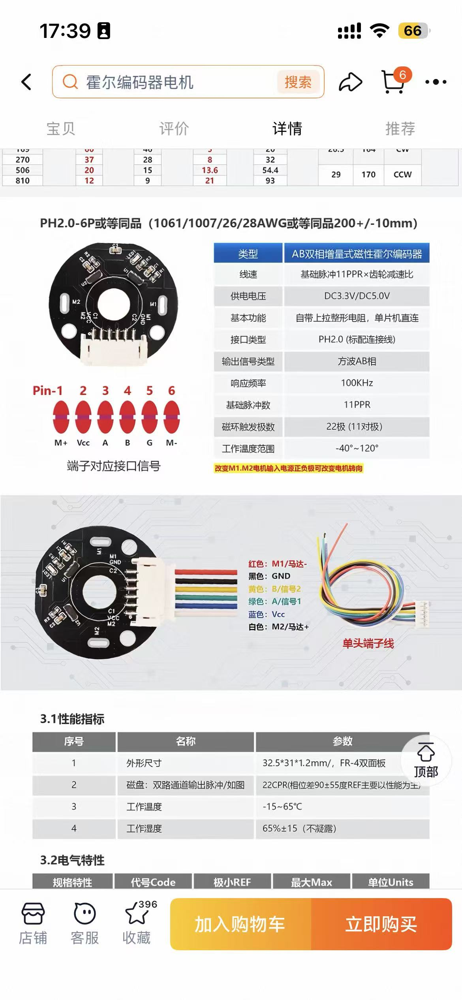

# 麦克纳姆平台硬件资料

## 参数与来源

| 项目 | 已知信息 | 来源及边界 |
|---|---|---|
| 上位机 | 鲁班猫 RK3588 | 用户确认；具体板型、内存及软件版本待补充 |
| 下位机 | STM32F407 | 当前仓库固件；实物烧录版本待记录 |
| 麦轮 | 直径80mm、宽38mm | 商家截图标称，带载有效轮径待测 |
| 底盘外廓 | 约297×236mm | 商品图示，实际含突出部件外廓待测 |
| 上层板 | 297×159mm，厚2mm | 商家上层板参数，不是整车 footprint |
| 电机 | 减速比1:90，额定85rpm，空载110rpm | 商品截图，是否对应实际购买规格待核实 |
| 编码器 | AB相，11PPR等标注 | 截图中另有22CPR说明，必须核实计数口径与倍频 |
| IMU | 仓库有HWT101相关驱动 | 实物型号及资料对应关系待确认 |
| 雷达 | 实车 launch 配置RPLIDAR C1 | 代码配置，具体实物铭牌待补充 |

## IMU 资料链接

[维特智能用户提供资料](https://wit-motion.yuque.com/wumwnr/wf4p82/ixl3wo5hkfipluy0)。此次无法读取网页正文，因此只保留来源链接，没有据此确认器件型号、协议或性能指标。

## 参数核对重点

固件当前 `CHASSIS_COUNTS_REV=4000`。如果实物确为11PPR、减速比90且定时器四倍频，则理论输出轴计数为3960；该计算仅为核对线索，不作为直接改值依据。应转动多圈实测。

`CHASSIS_K=0.195` 应核对是否等于前后轮中心距的一半加左右轮中心距的一半。上层板尺寸、外廓与轮中心距是不同量，不能互相替代。

接线截图是商品资料。实际端子朝向、线色与引脚需要核对实物；截图中的多个示意不能直接合并成未经验证的接线表。

## 图片原件

图片保持原样归档，Markdown控制展示宽度，不修改尺寸文字、接线或实物结构。原始照片不能用于精密测量。图片处理计划是裁切购物界面、调整实物展示曝光并制作标注版；本次没有生成修图版本，车头与轮序也尚未标注。

### 底盘装配照片

### 上层板尺寸（商品截图）

### 底盘外形（商家示意）

### 麦轮与部分电机参数（商品截图）

### 编码器参数与接线参考（商品截图）

商家截图中出现的其他模块不代表本车已安装。原硬件设计文件见 [firmware/docs/hardware](../firmware/docs/hardware/README.md)。
