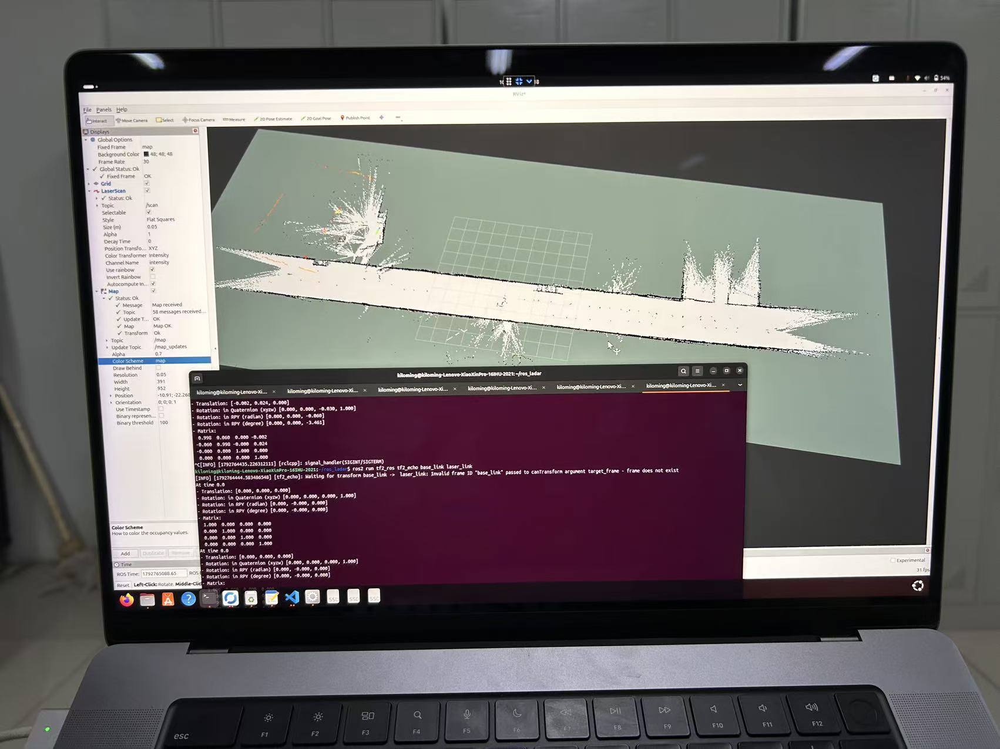

# Camsense X1 激光雷达建图基本测试（2026-10-23）

## 测试结果

已完成真实 Camsense X1 激光雷达建图的基本测试。测试者反馈扫描准确度已改善；提供的 RViz 测试照片显示 LaserScan 状态正常、Map received、Map OK，并已显示走廊场景的栅格地图。

本次记录依据测试者提供的终端截图、现场照片和反馈整理。此次提交没有重新连接硬件复测；完成范围为雷达扫描、激光里程计与地图生成链路的基本验证，不代表已完成导航、地图精度标定、闭环一致性或长期稳定性测试。

## 测试环境与已观察结果

- 测试主机：Ubuntu 24.04 / ROS 2 Jazzy；此记录对应电脑端测试，不是 ELF3588 板端部署验收。
- 雷达：Camsense X1，通过 CH340 串口连接，115200 波特率；此次成功打开的设备为 `/dev/ttyUSB1`，端口名可能随插拔变化。
- 雷达工作空间：`~/ros_ladar`；测试包名为 `ros_ladar_sv`，可执行程序为 `camsense_x1_node`，依赖 serial-ros2。
- 扫描话题 `/scan`，雷达坐标系 `laser_link`。
- RF2O 配置发布 `/odom_rf2o`，终端观测频率约 5 Hz；使用 `odom` 和 `base_link`，开启 TF 发布。
- 已查到 `odom → base_link` 动态变换，以及 `base_link → laser_link` 固定变换。测试截图中的雷达安装变换为单位变换；实车安装应使用实际测量外参。
- 最终现场照片显示 `/map` 已被 RViz 接收。未提供保存的地图文件或 rosbag，因此本提交只归档代码和测试证据。

## 调试要点

1. 串口路径不存在时会抛出 `serial::IOException (2)`；应先核对实际设备路径，而不是反复编译。
2. `/odom` 无输出不等于里程计未工作：此配置实际使用 `/odom_rf2o`。
3. 曾发现重复的同名 RF2O 节点；运行时应只保留一份，避免参数和 TF 冲突。
4. SLAM Toolbox 曾配置 `base_frame: base_footprint`，但现场 TF 中没有该坐标系，日志持续报 `Failed to compute odom pose`。配置应与实际 TF 一致，本次建议统一使用 `base_link`。最终参数文件未随测试资料提供，不能据此重建完整启动环境。

## 代码归档

- [用户提供的原始压缩包](../real_lidar/camsense_x1/camsense_x1_compatible.zip)
- [驱动源码](../real_lidar/camsense_x1/source/camsense_x1.cpp)
- [节点入口](../real_lidar/camsense_x1/source/camsense_x1_node.cpp)
- [配套头文件](../real_lidar/camsense_x1/source/camsense_x1.hpp)
- [压缩包原说明](../real_lidar/camsense_x1/source/README.txt)

压缩包与解压内容原样保存。它们是现有 ROS 2 包的替换源文件，不是独立完整的 colcon 包；沿用现有包的 CMakeLists.txt、package.xml 和 serial 依赖。源文件包含路径仍为 `camsense_x1/camsense_x1.hpp`，不要因 ROS 包名为 `ros_ladar_sv` 而遗漏相应头文件目录。

驱动修正了角度映射、缺测值、有效点筛选、完整帧接收和逐点跨圈处理，并先读取启动参数再打开串口。包内 `/8` 角度插值保持与可视化参考程序一致。

校验和公式尚未确认，因此只检查帧结构，没有实现未知校验算法。逐点时刻为估算值；反向扫描排序后 time_increment 为负，后续仍需核对算法兼容性。压缩包原说明中的“尚未硬件验收”是代码交付时的历史状态；本次后续基本测试结果以本记录为准。

## 后续验收

保存地图和原始扫描记录，检查移动时里程计稳定性、闭环后地图重合情况，并测量雷达安装外参；之后再开展与实车底盘结合的导航测试。
